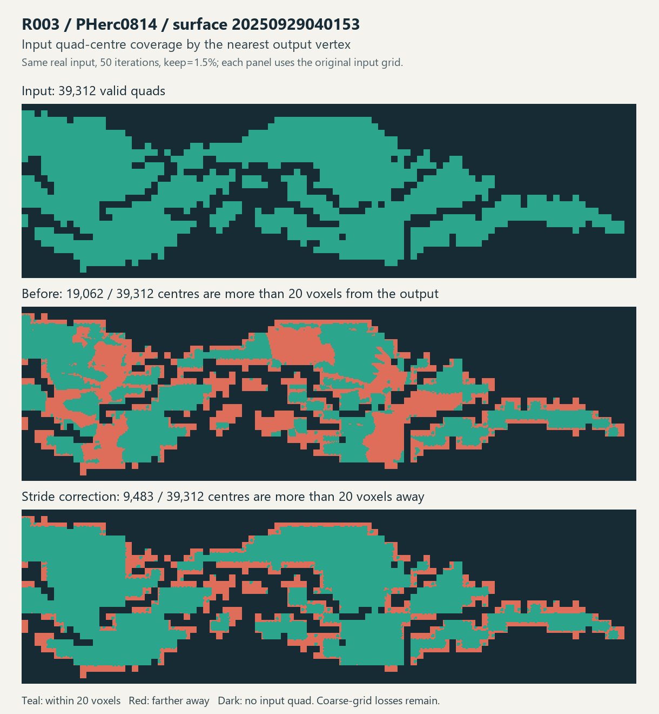

# R003: 初期UVの単位補正を実装し、一面で独立検証

2026-11-11 20:57 JST。heartbeat時間枠996887から継続した試行。主担当はAstra / xhigh、独立検証はgpt-6.1-sol / highへ逐次委任した。未決監査提案0件。R003の今回の実験は完了し、追加投入を区切る。研究全体はrunningを維持する。

## 結果と帰属

公開PHerc0814面 `20250929040153-auto_grown_20250929040153260` を同じ条件でflattenした。`--keep=1.5`、stride 8で、初期UVに元格子への倍率を戻すと出力の有効点が21,445から32,773へ増えた。入力の有効四角形39,312個すべての中心について、最近傍の出力点までの距離を測った。これは面積・対応関係・UV重なりを直接測る指標ではない。

| 指標 | 変更前 | stride補正 |
|---|---:|---:|
| 出力有効点 | 21,445 | 32,773 |
| 最近傍出力点まで20 CT voxels超の入力四角形中心 | 19,062 | 9,483 |
| 同40 CT voxels超 | 12,823 | 6,388 |
| 初期L2(mean)、表示値 | 8.25439 | 1.0318 |
| 最終L2(mean)、表示値 | 1.00064 | 1.00064 |
| UVをliftできず除外した三角形 | 225 | 225 |

`--keep=100` でも両バイナリを実行し、出力のx/y/z TIFFはバイト単位で一致した（有効40,684点、metaのUUIDは異なる）。4実行すべて終了コード0。既存SLIM assemblyの合成36系も成功した。keep=1.5の最終Area Errorは0.017604と0.0176075で微差があり、最適化結果全体が同じとは主張しない。

**原因、stride倍という修正式、18件の複数成分面と20件の単一成分面での先行比較は、[issue #2500のalpaltian](https://github.com/ScrollPrize/villa/issues/2500)の成果。** 今回はその最小実装と、主入力一面の再現・独立計測。新しい診断の発見や受賞と扱わない。作者の9,384→48という値は縮退していないUVセルに限定した別の指標で、上表と混同しない。

図の赤は中心から出力点まで20 CT voxelsを超える入力四角形、青緑は20以内。粗格子化とUV liftの損失を含み、補正後も欠落が残る。別の面片に近い点が最近傍になる可能性もあるため、重なりの完全解消・実表面積の保存・判読性の向上は未確認。

## 実装と条件

- 固定base: `7ad02f4f6e306b744ef6d2742dfe31fd55713ee5`。変更は `volume-cartographer/libs/flatboi/flatboi.cpp` の初期TCの2軸をstride倍する箇所とコメントだけ。
- [配布用LFパッチ](../experiments/vesuvius/r003/20261111-patch01/initial-uv-units-lf.patch)は元の保存パッチと改行だけが異なり、現作業ツリーへの逆適用チェックに成功。元CRLFパッチは保存したまま。[確認](../experiments/vesuvius/r003/20261111-patch01/distribution-check.json)
- ソース `D:/kensyoukin-work/r003-villa`、ビルド `D:/kensyoukin-work/r003-build`。変更前実行ファイルを同じbin内の `flatboi-baseline` に保存し、変更後の `flatboi` と分けた。両者のSHA-256は各実行stateと独立検証結果にある。
- WSL Ubuntu 24.04 / GCC 13 / CMake 3.28.3、CPUのみ、QuickBuild O0。50反復、symmetric_dirichlet、CPU affinity 0、各ライブラリ1スレッド、プロセスごとのアドレス空間上限4GiB、各実行300秒上限。W&Bは無効。
- 公開入力はmetaとXYZの計1,110,638 bytes。入力manifestを毎実行前に照合。[入力](../experiments/vesuvius/r003/20261111-input01/manifest.json)
- exFATの生成ヘッダー問題は[前記録](32-r003-exfat-header-workaround.md)の回避で解決。変更前ビルドは20:33 JSTに成功、再開部分1201.086秒。回避は両バイナリに共通で、このパッチには含めない。CMake再設定で生成ヘッダーが戻る可能性がある。

## 独立検証

別担当が入力・バイナリ・ソース差分・ビルド条件・201組の生成ヘッダーと原本・4実行の成果ハッシュを照合した。主担当のcKDTreeに対し、検証担当は保存TIFFを再読込し、256中心ずつ出力全点への `scipy.spatial.distance.cdist` で全探索して上表の個数を一致させた。検証担当によるflatboi再実行・再ビルドは行っていない。

最初の変更前keep=1.5実行のみ、初版runnerのハッシュ収集対象がoutput/内の4点に限られていた。出力は当時の記録と一致し、当時対象外だったログ等8点は検証時のハッシュを別途保存した。これを当時の取得記録に見せかけて追記していない。

[検証報告](33-r003-independent-verification.md)、[検証結果とハッシュ](../experiments/vesuvius/r003/20261111-verification01/result.json)。別面、別stride、非等方scale、GUI・OBJ・store経路、最適化ビルドでの性能は未検証。

## 投入と残すもの

今回のネイティブ実行はkeep=1.5が8.348秒と5.707秒、keep=100が114.905秒と119.533秒。各一回・O0であり、速度改善の測定ではない。ビルド、依存導入、調査、検証の時間はこれに含まれず、それぞれのログに残した。新規の有料計算調達は0 USD。LLM利用とローカル電力は金額換算していない。

再利用対象は、制限・入力照合・実行ハッシュを備えた[実験runner](../experiments/vesuvius/r003/run_flatboi.py)、元格子中心で比較する[距離評価](../experiments/vesuvius/r003/assess_coverage.py)、[比較図コード](../experiments/vesuvius/r003/plot_coverage.py)、[独立全探索](../experiments/vesuvius/r003/20261111-verification01/verify_saved_runs.py)、CPUビルド済みのflatboi。runnerは現入力と日付付き保存先を固定しているため、次の入力に使うときは複製して条件と保存先を明示する。登録済みの出力を上書きしない。

## 主担当の判断と次の投入

今回の修正仮説は一面の実データで支持され、stride 1の比較も通った。既に作者が広い比較を公開しているため、同じ追試を増やす投入はここで終了する。成果は[PR下書き](../experiments/vesuvius/r003/20261111-patch01/PR_DRAFT.md)まで保存し、公開・提出・賞金申請はしていない。上流の[CONTRIBUTING](https://github.com/ScrollPrize/villa/blob/7ad02f4f6e306b744ef6d2742dfe31fd55713ee5/CONTRIBUTING.md)はAI生成PRに人間自身の有用性コメントとレビューを求める。自動実行を本人の実利用やレビューと記載せず、テンプレートの本人確認欄は未チェックで保持した。公開へ進める場合には、具体物を提示した上で公開の指示と必要な本人コメントを受ける。

この投稿待ちだけで研究全体をholdにはしない。次のheartbeatでは未決監査提案を確認し、既存の候補・現行の募集と上流の未解決課題を照らして次の一件を選ぶ。既に他者が完成した診断の再現に偏ったR001〜R003の経緯を踏まえ、追加貢献が具体的に残る候補を優先する。候補はまだ未決定で、次の実験は未開始。C:空き容量が少ないため、新たな大きな取得・ビルド前には容量を確認し、D:の既存ビルドを活用する。

主担当登録は本チャット / local、日次監査09:00 JSTとheartbeat30分間隔は本ターンのviewと保存設定でACTIVEを再確認した。heartbeatの実配送とAstra / xhighへの再開は確認済み。日次監査の初回定刻配送は翌日09:00なので未確認。
