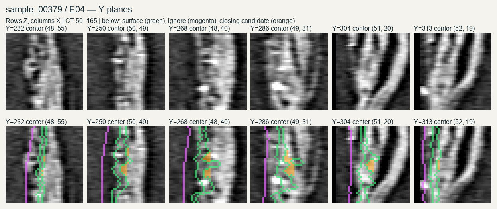

# R004: 学習ラベルのCUT候補を局在化し、切断は保留

2026-11-11 21:25 JST、heartbeat時間枠996888。実行中の計算と未決監査提案は0件だった。R003の追試完了後、[候補比較](35-next-contribution-sources.md)から、公開surfaceラベル `sample_00379` のE04一箇所を選んだ。資料収集はSol / medium、独立検査はSol / highへ逐次委任した。

**主担当の判断は、E04のラベル修正を保留すること。** 人の既存CUT判定と候補の位置は確認できたが、今回のCTから切断前後に残すべき二枚の紙面を同定できなかった。元ラベルの変更、修正TIFFの作成、学習は行っていない。これは「修正不可能」の証明ではなく、今回の小試行では正しい差分を決める根拠が不足したという結果。

## 入力と再現できたこと

[公開CT](https://huggingface.co/buckets/scrollprize/datasets/resolve/surfaces/kaggle/images/sample_00379.tif)と[公開ラベル](https://huggingface.co/buckets/scrollprize/datasets/resolve/surfaces/kaggle/labels/sample_00379.tif)の一組、計63,197,735 bytes（約60.27 MiB）を取得。いずれも320×320×320のuint8。ラベル0は23,334,439点、1は2,078,214点、ignore 2は7,355,347点だった。元TIFFと配列のSHA-256は[入力manifest](../experiments/vesuvius/r004/20261111-input02/manifest.json)に保存。実データは `D:/kensyoukin-work/r004-input01/` に置いた。

TIFFの軸表記はQYXでZの明記はない。公開の `center_zyx` 規約に従いページ軸をZと解釈し、元監査の座標と個数を再現した。独立担当もTIFFのページとNPYの軸0の画素が一致することを確認した。原巻物上の絶対位置や向きは今回確定していない。

初回のCT読出しはtifffileのLZW追加デコーダー不足で止まった。CTファイルの取得自体は完了していたため再取得せず、既存Pillowでページを読み出した。描画もPillowを使い、追加パッケージは導入していない。ラベルを背景・表面へ二値化してignoreを失わせる処理は保存入力に行っていない。

元監査PR #2147の固定head `b67f708eb9eb42270ff1664af411ab3dcfb9e3fd` から、`component_betti` と `locate_holes` 等の計算関数を借りた。初期の26近傍ラベリングのみcc3dの代わりに既存SciPyを使用。ソースは現在 `vesuvius/src/vesuvius/label_processing/` にあり、READMEの旧 `image_proc/` パスは404だった。[取得ソース](../experiments/vesuvius/r004/20261111-localization/source-manifest.json)

| 確認項目 | 結果 |
|---|---|
| E04の中心（z,y,x） | (49,274,36)、既報と一致 |
| E04のクロージング候補 | 1,617ボクセル、既報と一致、全点が元ラベル0 |
| E04の範囲、両端を含む | (42,227,9)〜(55,316,56) |
| 同成分のE05 | 中心(125,33,60)、833ボクセルも既報と一致 |
| 元の対象表面成分 | 317,632ボクセル、b1=17、b2=0 |
| E04候補を埋めた際のb1減少 | 15。正しい修正の証拠ではない |
| 元監査関数による局在化 | CPU 1個へaffinityを指定、約1.98秒 |

この候補は、26近傍の3段階クロージングで加わり、b1を下げる背景領域。元の背景の閉空洞や、削除する橋のマスクではない。整数中心自体は表面1である。人のCUT判定は、[Wittmoonの既存監査](https://github.com/Wittmoon/vesuvius-label-topology-audit/blob/6a65a564fc239fe4d2d3d797d77b963697ef5d50/data/errata.csv)に帰属する。一人の非専門家による判定であり、ボクセル単位の正解注釈として扱わない。

## 切断に進まなかった根拠

主担当の直交断面に続き、別担当がZ・Y・Xの連続断面と候補全長の断面を確認した。明るい帯が接近・分岐し、削除すべき橋と残すべき紙面の経路を両端で対応付けられなかった。AI二者の目視は専門家の正解注釈の代わりではない。

候補の面隣接外周にはignore 2が7点あり、例えば候補の(46,316,9)はignoreの(46,317,9)と接していた。中心だけの確認や、全体の連結成分数・b1の改善だけで切断を決めると、未評価領域の影響や残すべき経路を見落とす。独立担当は元データとハッシュ、値、領域を直接確認したが、元監査の局在化を別アルゴリズムで再実装した検証ではない。[独立検査](37-r004-independent-inspection.md)

## 投入の区切りと再利用

45分の成立性確認枠・80 MiBの取得上限で始め、約20分の調査と実データ確認で判断した。この時間は主担当の経過時間の概数で、LLM計算量や人時ではない。新規の有料計算は0 USD、GPU・クラウドは使っていない。LLM利用とローカル電力の金額は未計上。

残すものは、元データの参照・ハッシュ、[既存デコーダーによる読出しと断面図](../experiments/vesuvius/r004/20261111-input02/probe_input.py)、[上流関数を利用した局在化](../experiments/vesuvius/r004/20261111-localization/localize_e04.py)、[独立した断面・値の検査](../experiments/vesuvius/r004/20261111-independent-inspection/inspect_e04.py)。未修正入力と結果は登録後に上書きしない。

E04の再開条件は、より広い登録済み紙面の追跡か専門家の注釈により、局所の両側で二枚を識別し、保持する経路を指定できること。現段階で本人へ切断位置を尋ねる必要はない。ラベル品質・学習精度の改善や受賞は主張しない。公開・提出は未実施。

研究全体はrunningを維持する。次の投入候補は、手元のflatboi実験に残った欠落を元の幾何に対して判定できるかの確認。R003で終了した「既報の初期UV補正の追加追試」とは別の問いで、まず上流の仕様・既存修正との重複を確認する。次の実験はまだ起動していない。
